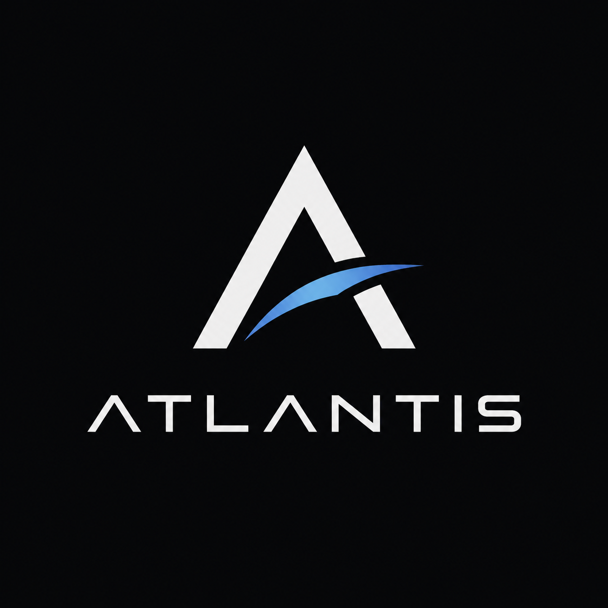
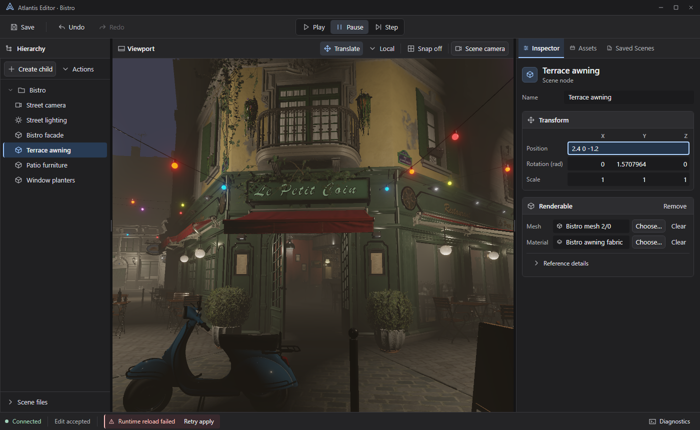

# Atlantis

<p align="center">
  
</p>

<p align="center">
  
</p>

<p align="center"><em>Atlantis Editor design preview featuring the
<a href="https://developer.nvidia.com/orca/amazon-lumberyard-bistro">Amazon Bistro</a> reference scene.</em></p>

Atlantis is a long-term, real-time rendering engine written in C++20,
built on a backend-independent RHI (currently Vulkan) and a RenderGraph,
targeting **Windows and Android**. It is in active development; see
[docs/specs/README.md](docs/specs/README.md) for the current, authoritative
status of every module.

## Features

**Platform**
- Windows and Android, sharing one Renderer/RHI/RenderGraph stack
  (Android via Vulkan WSI + NDK; APK packaging with Gradle)
- Windowed and headless rendering through the same code path

**Rendering**
- Physically based rendering: metallic-roughness BRDF, image-based
  lighting (SH irradiance, prefiltered specular, DFG LUT), tangent-space
  normal mapping
- Clearcoat, sheen (cloth), and anisotropy BRDF extensions
- Up to 64 point lights + 1 directional light with shadow; point lights are
  associated per view-space cluster on the CPU (a 64-bit light mask per
  cluster), so each fragment evaluates only the lights that can reach it —
  with the image provably unchanged
- Emissive materials (factor + texture)
- Alpha blending and alpha testing (cutout) with back-to-front CPU
  draw-order sorting
- Height-based exponential fog (HDR colour, per-scene parameters)
- Bloom (downsample/upsample chain, 6 levels, threshold + strength)
- BC7 block-compressed textures with full mip-chain passthrough
- HDR color pipeline with tone mapping and manual camera exposure

**Assets & Tooling**
- glTF 2.0 scene importer (meshes, materials, textures, scene graphs,
  64-bit index meshes)
- A build-time Slang → SPIR-V shader pipeline
- A deterministic authoring-source → runtime-artifact Asset System
- Image-regression testing against human-reviewed golden images
  (30 golden images, 67 comparisons per configuration, zero tolerance)

**Runtime, tools & SDKs**
- A Runtime ECS world with GUID-stable identity, an asset catalog, schema
  reflection, and an authoring scene baked into the runtime world
- One client connection to a running Runtime — query, command, event and
  transaction — with the `atlantis` CLI as its client; a Runtime started
  with `--listen` is attachable over loopback (`atlantis.remote/1`)
- A minimal editor (`--editor`: hierarchy, schema-generated inspector,
  viewport with a free editor camera and click picking, transform gizmo with
  world/local space and snapping, undo/redo of gizmo drags and inspector
  edits) built on Dear ImGui, as an ordinary client — frozen as the
  in-process debug tool
- An authoring data layer: the Runtime hosts the open scene document, which
  every client edits through one interface (in process, over
  `atlantis.remote/1`, the CLI's `scene` commands and the C# SDK) with
  all-or-nothing validated transactions; an explicit apply reloads the
  Runtime's scene at a frame boundary, and a hand-authored scene saves back
  losslessly to its source
- Gameplay SDKs in C++ and C# (.NET 10, zero NuGet dependencies) with
  typed bindings generated from the schema
- The first cut of the product editor, Atlantis Editor App: a separate
  C#/Avalonia process (`src/editor_app/`, built only with
  `-DATLANTIS_BUILD_EDITOR_APP=ON`) that embeds the Runtime's Viewport as a
  child window, orbits its camera and picks entities over the same
  `atlantis.remote/1` interface as every other client, outlining the
  picked entity and drawing a translate Gizmo through a per-client
  Viewport overlay the Runtime draws after the scene

**Performance**
- `ATL_PROFILE_*` instrumentation that compiles to nothing by default, GPU
  timestamps and counters, RenderDoc-readable names, an optional Tracy sink
- `atlantis_runtime --benchmark`: a fixed-resolution measured loop with a
  versioned JSON report
- A Performance Contract: `atlantis_runtime --gate` judges a change against
  committed per-hardware baselines (counters exact, CPU gated, GPU
  reported); see [docs/process/performance-contract.md](docs/process/performance-contract.md)
- Measured under it: on the reference iGPU, Bistro's point-light cost went
  from 10.19 to 0.61 ms and its median frame time from 27.97 to 18.96 ms
  ([Spec 0061](docs/specs/0061-point-light-cost.md))

**Sample scenes** — `--list-scenes` in the Runtime binary: integrated
showcase (multi-object PBR), IBL material demo, normal-map demo,
clearcoat/sheen/anisotropy showcase, and the full Bistro reference scene
(once its content is fetched — see Building). The transparency, fog and
bloom demos are image-regression scenes.

iOS is a future target — backend undecided (MoltenVK vs. a native Metal
RHI backend). Linux is not a target platform.

## Spec-Driven Development

Atlantis is built with a strict, enforced workflow so that architecture is
always a deliberate, reviewed decision — including (especially) when the
work is done by an AI agent:

```
Spec  →  Plan  →  Human Review  →  Implementation  →  Verification  →  PR  →  Merge
```

| Stage | Lives in | Purpose |
|---|---|---|
| Spec | [docs/specs/](docs/specs/) | What problem, what requirements, what design, what's out of scope |
| Plan | [docs/plans/](docs/plans/) | How an approved spec becomes an ordered, reviewable set of changes |
| Human Review | — | Explicit human sign-off on spec + plan before implementation begins |
| ADR | [docs/adr/](docs/adr/) | Permanent record of any architectural decision and why it was made |
| Implementation | `src/`, `tests/` | Code written strictly against the approved plan |
| Verification | PR | Checked against the plan's verification checklist and the [Definition of Done](docs/process/definition-of-done.md) |
| PR → Merge | GitHub | An agent opens the PR; a human reviews and merges — never the reverse |

See [AGENTS.md](AGENTS.md) for the full rules that govern this — including
for AI agents working in this repo — and
[docs/process/git-workflow.md](docs/process/git-workflow.md) for how this
maps onto branches and PRs.

## Repository layout

```
AGENTS.md          Canonical agent operating rules (read this first)
CLAUDE.md          Claude Code–specific pointer to AGENTS.md
README.md          This file
docs/
  specs/           Proposed work, pre-implementation (specs/README.md is the status registry)
  plans/           Approved implementation plans
  adr/             Architectural decision records
  architecture/    As-built design records
  process/         Prescriptive process docs (git workflow, Definition of Done, CI/testing strategy)
  project-blueprint.md   Roadmap and status navigation index
src/               Source — see src/README.md for the full, up-to-date per-module breakdown
examples/          Non-shipping demo programs
tests/             Tests — see tests/README.md for what each suite covers
shaders/           Shader sources (Slang)
assets/            Engine/sample assets
tools/             Offline/dev tooling
cmake/             CMake helper modules
.github/           PR template and repository automation
```

For a full architecture overview and navigation entry point, see
[docs/architecture/engine_architecture.md](docs/architecture/engine_architecture.md).
For direction and roadmap beyond what's currently approved, see
[docs/project-blueprint.md](docs/project-blueprint.md) — naming a
milestone there does not authorize implementing it; every one still
requires its own Spec.

## Building

Requires CMake 3.21+, a C++20 compiler (MSVC, Windows), the Windows SDK,
and a pre-installed [Vulkan SDK](https://vulkan.lunarg.com/). CMake locates
the Vulkan SDK via `find_package(Vulkan REQUIRED)` — configuration fails
outright if no Vulkan SDK is found. If it is not discovered
automatically, set the `VULKAN_SDK` environment variable for the current
shell session before configuring, e.g.:

```
$env:VULKAN_SDK = 'C:\VulkanSDK\<version>'
```

The Vulkan SDK is an external prerequisite installed separately, not a
dependency this project downloads (see [ADR-0006](docs/adr/0006-dependency-management.md)'s
external-system-dependency category). The remaining third-party libraries
are fetched by CMake `FetchContent` on first configure, each pinned by
version and hash: Catch2 v3 (tests), stb, Dear ImGui (the editor), cgltf
(the host-only glTF importer) and, in a profiling build only, Tracy. The
C# SDK builds only when a .NET 10 SDK is found. Atlantis Editor App
(`-DATLANTIS_BUILD_EDITOR_APP=ON`, off by default) is the one place NuGet
packages are allowed: Avalonia, pinned exactly with committed lock files and
restored in locked mode from nuget.org or an offline feed
([ADR-0127](docs/adr/0127-editor-application-managed-dependency-policy.md)).

The Bistro scene's content is large and never committed. Fetch it once
(pinned and SHA-256 verified), then re-configure:
```
tools/content/fetch_bistro.ps1
```

```
cmake -S . -B build
cmake --build build --config Debug
cmake --build build --config Release
```

Run the GPU-independent test suite (excludes the Vulkan GPU integration
tests):
```
ctest --test-dir build -C Debug -LE gpu --output-on-failure
```
Run the GPU-required Vulkan integration tests, which need a real,
Vulkan-capable Windows machine (replace `Debug` with `Release` for a
Release build):
```
ctest --test-dir build -C Debug -L gpu --output-on-failure
```
A bare `ctest` runs every registered test regardless of label, including
the GPU-required ones — prefer the explicit `-LE gpu`/`-L gpu` commands
above. See [tests/README.md](tests/README.md) for what each suite covers.

Run the real product binary (`--help` lists every mode):
```
build/src/runtime/Debug/atlantis_runtime.exe --scene bistro
```
(path varies by generator/configuration). Beyond `--scene` and
`--list-scenes`, it accepts `--listen <port>` (attachable by the
`atlantis` CLI), `--editor`, `--parent-window <HWND>` (the Viewport as a
child of another process's window, as Atlantis Editor App starts it), and,
in a profiling build
(`-DATLANTIS_PROFILING=ON`), `--benchmark <scene>` and `--gate`; see
[docs/process/profiling.md](docs/process/profiling.md) and
[docs/process/performance-contract.md](docs/process/performance-contract.md).
Cooked asset discovery (Spec 0081) uses the same shared interface in every client:
`atlantis --session <file> asset list` or `asset get <guid>` (`--json` for structured
output); C++ `gameplay::Assets(session.assets())`; C#
`session.Assets.ListAssets()` / `GetAsset(guid)`; MCP `assets.list` / `assets.get`.
The product editor's Assets tab provides local filters, details, dependency
navigation and Copy GUID; paste into an existing Inspector reference field to edit.
The catalog is fixed at the first valid query, including an initial failure.
Reload view and reconnect do not reread disk; restart Runtime after a changed
build or a repaired initial failure. See the [shared contract](docs/architecture/remote_protocol.md#52-cooked-asset-queries-spec-0081--adr-0143).

Select a mesh and choose **Preview geometry** to render one read-only,
256 × 256 still. It shows the mesh's vertex colors with a fixed camera,
independent of the scene's materials, lighting and camera. The same call is
available as `atlantis --json asset preview <guid>`, C++ `previewMesh(guid)`,
C# `session.Assets.PreviewMesh(guid)`, and MCP `assets.preview_mesh`.
The image uses the connected Runtime's existing catalog; a newly published
asset is available after restarting into the new generation.

With a mesh selected, choose a material and click **Preview with material**
to see the pair under a fixed white directional light. This preview accepts
opaque base PBR materials with one sRGB RGBA8 texture and no normal map
or emissive input. The same operation
is available as `atlantis --json asset preview-material <mesh-guid> <material-guid>`,
C++ `previewMeshMaterial`, C# `Assets.PreviewMeshMaterial` and MCP
`assets.preview_mesh_material`.

Inspector asset-reference fields also offer **Choose…** (F4 while editing the
field). Choose a catalog GUID and Confirm to make one ordinary undoable edit;
Cancel discards the choice. Pointer/F4 launch discards that field's uncommitted
text draft. Tabbing away keeps normal text-commit behavior. When the authoring
schema declares a target type, the chooser offers that type from the fixed
Runtime catalog. Use `scene schema Renderable` to inspect the declarations.
On a host without this metadata the chooser keeps its manual type filters.
A type match can still fail during Runtime apply (Specs 0082 and 0084).
The `Renderable.materialAsset` chooser can preview a candidate using the
mesh shown as **Mesh at opening**. Reopen the chooser to preview with an
updated mesh. Preview leaves Confirm and the scene's edit history independent.

For managed asset rebuild on Windows, configure a dedicated staging build
from the same checkout, generator, configuration and content options as the
Runtime build. Create a separate empty publication directory. The local
profile names the existing absolute directories as JSON, for example
`{"stagingBuild":"D:/atlantis-stage","publicationRoot":"D:/atlantis-published"}`.
Keep the Runtime build, staging build and publication root disjoint.
Launch Runtime or Editor with `--asset-build-profile <file>`. Only its
coordinator writes the staging build while the profile is active.

Use **Rebuild selected** in Assets or `assets rebuild <GUID>` in the CLI.
Poll `assets rebuild-status <JobId>` for the published generation or failure.
Runtime continues using its original files until a new process is launched
with the same profile and `--asset-generation <GUID>`. Save any hand-authored
document changes that should survive restart. Imported sources come from the
selected generation. The local build log is `asset-rebuild.log` in staging.
For `WorkspaceNeedsRepair`, stop the profile's Runtime processes, verify
the build descendants have exited, and recreate or validate the staging
build before clearing `.atlantis-rebuild-dirty`. Keep staging offline until
repair is complete. Remove old generations only with their consumers stopped.

Authoring apply has two stages: the document snapshot is accepted, then the
Runtime attempts to load it. Use `scene apply` for a receipt and
`scene apply-status [id]` to inspect its outcome. Both SDKs and MCP expose
the same tracked apply and read-only status. A paused Runtime can keep the
receipt pending until Step or Resume. In Editor App, a failed reload keeps
the document and its undo/redo history; repair or undo the edit, then choose
**Retry apply**. Save still writes only the document, where supported.

See [examples/](examples/) for smaller, single-purpose demo programs.

### Register a new static mesh

On Windows, create a trusted project directory outside the checkout and build
trees with `inbox` and `registered` subdirectories. Configure the seed and
dedicated staging builds with `-DATLANTIS_MANAGED_IMPORT_ROOT=<project>`
and the same generator, configuration and base content. Build the seed
and use a separate, empty publication directory. Add `importProject` to the
existing local asset-build profile alongside `stagingBuild` and `publicationRoot`.

Place a self-contained untextured static-mesh `<name>.gltf` in `inbox`.
Run `atlantis assets import <name>` against the managed Runtime and query
`atlantis assets import-status <JobId>`. The Assets panel offers the same
operation. Restart explicitly with the profile and returned generation,
then select the new mesh in the existing scene Inspector. Back up
`registered` with any hand-authored scenes that reference imported GUIDs.
A clean opt-in build reads the committed registrations.

In a hand-authored scene, select a Mesh in Assets and choose **Add to Scene**.
The Editor selects the new root node at the origin. It uses the Runtime's
fallback material until you assign one. Undo/Redo covers the whole node and
Save writes the scene source. If Runtime reload fails, the node remains in
the document. Correct the input and use **Retry Apply** to refresh the Runtime.

If publication failed after registration, use `assets import <name> --resume`
after correcting the failure. This uses the committed input and GUID. If
repair is required, stop the hosts, confirm their children exited and
inspect the project marker's staging and publication paths. Check the
registered unit and any complete generation. Recreate or validate staging,
clear its pending selection, and remove both dirty markers only after
settlement is known. See [Spec 0086](docs/specs/0086-new-asset-import.md).

#### Create and edit a basic material

Start the Editor's Runtime with the trusted managed asset build profile.
In **Assets → Materials**, choose **New material**, **Duplicate** for an
eligible PBR material, or **Edit material** for a managed material. Select
an existing sRGB base texture, set linear RGB, metallic and roughness, and
choose a mesh for an optional **Preview draft**. **Save & Publish** starts
an asset job; it does not edit, apply, or save the current scene. Wait for
its matching receipt. Restart the Runtime explicitly with the returned
`--asset-generation <GUID>` before referencing the new material or doing
another write. Editing preserves existing material GUID references.

The same contract is available as `atlantis assets material-read <GUID>`,
`assets material-save <JSON>`, `assets material-status [<JobId>]`, and
`assets preview-material-draft <MeshGuid> <RecipeJSON>` (use `--json` for PNG
bytes), through both SDKs, and through the corresponding `assets.*` MCP
tools. Use the [wire request shapes](docs/architecture/remote_protocol.md#522-managed-materials-spec-0094--adr-0153).
A clean precommit failure allows an explicit retry. If source committed
but publication failed, retain its GUID and use **Resume publication**
or `{"mode":"Resume","material":"<GUID>"}` after correction. If admission or
settlement is unknown, keep the job ID if known and confirm settlement
and the durable state before retrying. See
[Spec 0094](docs/specs/0094-basic-material-authoring.md).


#### Import a base color texture

Place an 8-bit RGB or RGBA PNG at `inbox/<name>/source.png` in the opted-in
managed project. In **Assets → Import Texture**, enter the inbox name and
choose **Register**. The producer interprets the RGB samples as sRGB.
Restart into the reported generation to find the texture in Assets and
choose it in the material's **Base texture** field. Preview on a mesh,
choose **Save & Publish**, then restart into the material generation.
The edited material keeps its GUID, so a saved scene keeps its reference.
Saved Scenes builds use the committed managed project root.

Use `assets texture-import <name> [--resume]` and
`assets texture-import-status [<jobId>]` from the CLI. The same operation
is available from both SDKs and MCP. If registration succeeded but
publication failed, use **Resume** after settlement or offline repair.
If the result is unknown, inspect the registered PNG, its fragment and
seal, and complete generations before retrying. See
[Spec 0095](docs/specs/0095-texture-import-and-base-color-binding.md).

In the material editor, choose a cooked RGBA8 UNORM normal map and an
optional RGBA8 sRGB emissive texture. The emissive RGB factor is linear.
Clearing the normal map restores geometric normals. Clearing the
emissive texture keeps the factor and samples white. Preview the draft on
a mesh, then use **Save & Publish** and restart into the reported generation.
CLI uses `assets material-read-with-maps`, `assets material-save-with-maps`
and `assets preview-material-draft-with-maps`. Query the same receipt via
`assets material-status`. [Spec 0096](docs/specs/0096-pbr-texture-editing.md).

To import a tangent-space +Y normal map, use the same inbox layout and
choose **Normal map** in Assets, or use `assets normal-map-import <name>`
with `assets normal-map-import-status [<JobId>]`. The cooker preserves
the PNG samples as one-mip RGBA8 UNORM. Activate the named generation
before assigning the resulting GUID to the material's Normal map slot.
If publication failed after registration, use the same import with
`--resume`. [Spec 0097](docs/specs/0097-linear-normal-map-import.md).


### Save a hand-authored scene copy

In a Windows development checkout on local NTFS, create the ordinary
directory `assets/scenes/saved`. Start that build's Runtime with
`--allow-scene-save-as --listen 0 --session-file <file>`. Open the scene
through `atlantis --session <file> scene open`, or attach the Editor to that
session. Use `scene save-as <name>` or the Editor's **Save As** action.
Save As captures accepted edits under `assets/scenes/saved/save_<name>`.
The original remains open and its ordinary Save still targets its source.

Configure a separate development build with `-DATLANTIS_SAVED_SCENE=<name>`.
Supply the same `ATLANTIS_MANAGED_IMPORT_ROOT` when the copy references managed
meshes. Build `atlantis_runtime` and launch it with `--scene saved_scene`.
Ordinary `scene open` and Save in that session target the copy. This build
uses its own cooked catalog and accepts no asset build profile or generation.

An occupied name is never overwritten. After losing a reply, inspect the
unit's source and catalog fragment. If it is absent, confirm the earlier
request can no longer commit before retrying. See
[Spec 0088](docs/specs/0088-scene-save-as.md).

### Create a hand-authored scene

Use the same Windows development checkout and saved directory as Save As.
Launch the ordinary Editor with `--allow-scene-save-as` and use **New Scene**,
or run `atlantis --session <file> scene create <name>` against an opted-in
Runtime. Creation writes a separate camera-only scene and reports its relative
source path. The current session keeps its document, unsaved edits and undo history.

Configure a separate build with `-DATLANTIS_SAVED_SCENE=<name>`, then build
`atlantis_runtime`. Start a second Editor with
`--runtime <new-build-runtime> --scene saved_scene`, or start that Runtime
directly with `--scene saved_scene`. If this step fails, fix the build or
launch and retry it using the same name. The created source remains available.
For a lost creation reply, follow the saved-unit inspection guidance above.
See [Spec 0089](docs/specs/0089-new-hand-authored-scene.md).

### Build and open a saved scene in Editor

Start the ordinary Windows `Atlantis.Editor.exe` with
`--saved-scene-checkout <absolute-checkout> --saved-scene-cmake <absolute-cmake.exe>`.
Use a trusted local checkout and CMake installation with Visual Studio 18 2026
x64 support. The separate `--allow-scene-save-as` option grants New Scene and
Save As authority if needed.

In **Saved Scenes**, refresh and select the local unit. Supply an absolute
committed managed import root if the unit references managed assets. **Build**
runs the saved-slot Debug build and retains its directory and log. **Open**
starts another Editor on that build. Check its window for Runtime and document
readiness. Its ordinary Save writes to the saved unit. After a source or
executable change, build again before opening. The manual CMake recipe above
uses the same saved slot.

## Status

In active development. See [docs/specs/README.md](docs/specs/README.md) for
the full, authoritative registry of every Spec's status, its Plan, and
its implementation PR(s).

## License

Licensed under the [Apache License, Version 2.0](LICENSE).
