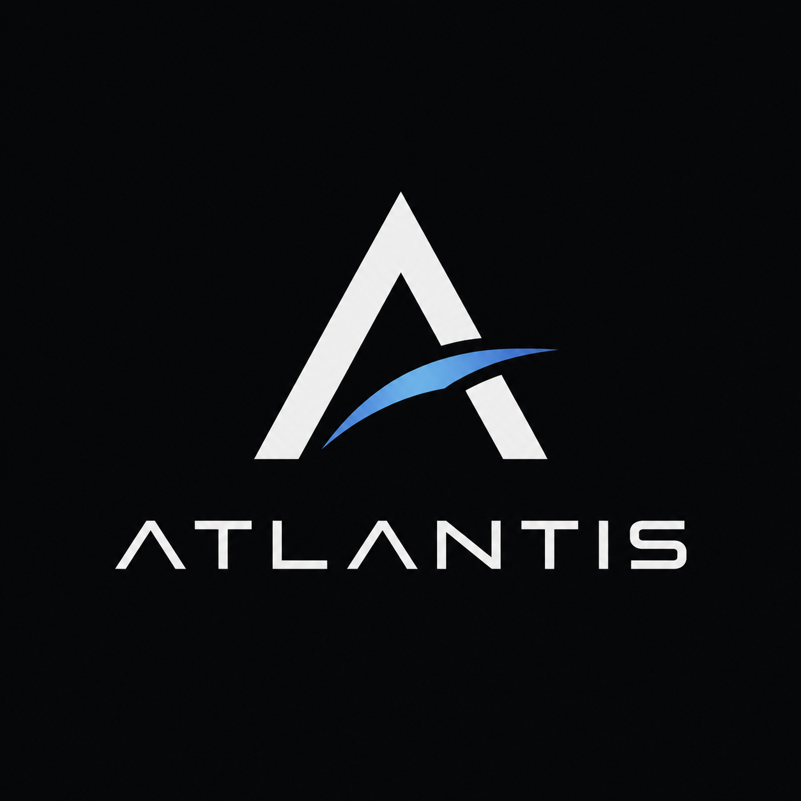
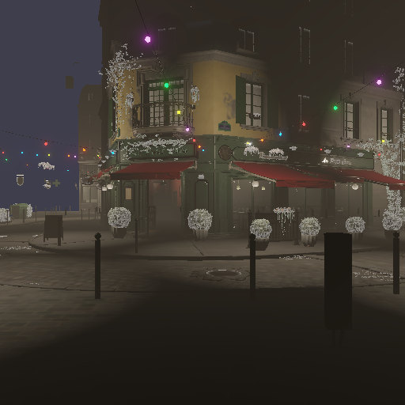

# Atlantis

<p align="center">
  
</p>

<p align="center">
  
</p>

<p align="center"><em>Atlantis rendering the <a href="https://developer.nvidia.com/orca/amazon-lumberyard-bistro">Amazon Bistro</a> reference scene —
glTF import, 59 point lights through a clustered light association, emissive materials, alpha cutout, height fog,
and bloom, in one frame.</em></p>

Atlantis is a long-term, real-time rendering engine written in C++20,
built on a backend-independent RHI (currently Vulkan) and a RenderGraph,
targeting **Windows and Android**. It is in active development; see
[docs/specs/README.md](docs/specs/README.md) for the current, authoritative
status of every module.

## Features

**Platform**
- Windows and Android, sharing one Renderer/RHI/RenderGraph stack
  (Android via Vulkan WSI + NDK; APK packaging with Gradle)
- Windowed and headless rendering through the same code path

**Rendering**
- Physically based rendering: metallic-roughness BRDF, image-based
  lighting (SH irradiance, prefiltered specular, DFG LUT), tangent-space
  normal mapping
- Clearcoat, sheen (cloth), and anisotropy BRDF extensions
- Up to 64 point lights + 1 directional light with shadow; point lights are
  associated per view-space cluster on the CPU (a 64-bit light mask per
  cluster), so each fragment evaluates only the lights that can reach it —
  with the image provably unchanged
- Emissive materials (factor + texture)
- Alpha blending and alpha testing (cutout) with back-to-front CPU
  draw-order sorting
- Height-based exponential fog (HDR colour, per-scene parameters)
- Bloom (downsample/upsample chain, 6 levels, threshold + strength)
- BC7 block-compressed textures with full mip-chain passthrough
- HDR color pipeline with tone mapping and manual camera exposure

**Assets & Tooling**
- glTF 2.0 scene importer (meshes, materials, textures, scene graphs,
  64-bit index meshes)
- A build-time Slang → SPIR-V shader pipeline
- A deterministic authoring-source → runtime-artifact Asset System
- Image-regression testing against human-reviewed golden images
  (30 golden images, 67 comparisons per configuration, zero tolerance)

**Runtime, tools & SDKs**
- A Runtime ECS world with GUID-stable identity, an asset catalog, schema
  reflection, and an authoring scene baked into the runtime world
- One client connection to a running Runtime — query, command, event and
  transaction — with the `atlantis` CLI as its client; a Runtime started
  with `--listen` is attachable over loopback (`atlantis.remote/1`)
- A minimal editor (`--editor`: hierarchy, schema-generated inspector,
  viewport with a free editor camera and click picking, transform gizmo with
  world/local space and snapping, undo/redo of gizmo drags and inspector
  edits) built on Dear ImGui, as an ordinary client — frozen as the
  in-process debug tool
- An authoring data layer: the Runtime hosts the open scene document, which
  every client edits through one interface (in process, over
  `atlantis.remote/1`, the CLI's `scene` commands and the C# SDK) with
  all-or-nothing validated transactions; an explicit apply reloads the
  Runtime's scene at a frame boundary, and a hand-authored scene saves back
  losslessly to its source
- Gameplay SDKs in C++ and C# (.NET 10, zero NuGet dependencies) with
  typed bindings generated from the schema
- The first cut of the product editor, Atlantis Editor App: a separate
  C#/Avalonia process (`src/editor_app/`, built only with
  `-DATLANTIS_BUILD_EDITOR_APP=ON`) that embeds the Runtime's Viewport as a
  child window, orbits its camera and picks entities over the same
  `atlantis.remote/1` interface as every other client

**Performance**
- `ATL_PROFILE_*` instrumentation that compiles to nothing by default, GPU
  timestamps and counters, RenderDoc-readable names, an optional Tracy sink
- `atlantis_runtime --benchmark`: a fixed-resolution measured loop with a
  versioned JSON report
- A Performance Contract: `atlantis_runtime --gate` judges a change against
  committed per-hardware baselines (counters exact, CPU gated, GPU
  reported); see [docs/process/performance-contract.md](docs/process/performance-contract.md)
- Measured under it: on the reference iGPU, Bistro's point-light cost went
  from 10.19 to 0.61 ms and its median frame time from 27.97 to 18.96 ms
  ([Spec 0061](docs/specs/0061-point-light-cost.md))

**Sample scenes** — `--list-scenes` in the Runtime binary: integrated
showcase (multi-object PBR), IBL material demo, normal-map demo,
clearcoat/sheen/anisotropy showcase, and the full Bistro reference scene
(once its content is fetched — see Building). The transparency, fog and
bloom demos are image-regression scenes.

iOS is a future target — backend undecided (MoltenVK vs. a native Metal
RHI backend). Linux is not a target platform.

## Spec-Driven Development

Atlantis is built with a strict, enforced workflow so that architecture is
always a deliberate, reviewed decision — including (especially) when the
work is done by an AI agent:

```
Spec  →  Plan  →  Human Review  →  Implementation  →  Verification  →  PR  →  Merge
```

| Stage | Lives in | Purpose |
|---|---|---|
| Spec | [docs/specs/](docs/specs/) | What problem, what requirements, what design, what's out of scope |
| Plan | [docs/plans/](docs/plans/) | How an approved spec becomes an ordered, reviewable set of changes |
| Human Review | — | Explicit human sign-off on spec + plan before implementation begins |
| ADR | [docs/adr/](docs/adr/) | Permanent record of any architectural decision and why it was made |
| Implementation | `src/`, `tests/` | Code written strictly against the approved plan |
| Verification | PR | Checked against the plan's verification checklist and the [Definition of Done](docs/process/definition-of-done.md) |
| PR → Merge | GitHub | An agent opens the PR; a human reviews and merges — never the reverse |

See [AGENTS.md](AGENTS.md) for the full rules that govern this — including
for AI agents working in this repo — and
[docs/process/git-workflow.md](docs/process/git-workflow.md) for how this
maps onto branches and PRs.

## Repository layout

```
AGENTS.md          Canonical agent operating rules (read this first)
CLAUDE.md          Claude Code–specific pointer to AGENTS.md
README.md          This file
docs/
  specs/           Proposed work, pre-implementation (specs/README.md is the status registry)
  plans/           Approved implementation plans
  adr/             Architectural decision records
  architecture/    As-built design records
  process/         Prescriptive process docs (git workflow, Definition of Done, CI/testing strategy)
  project-blueprint.md   Roadmap and status navigation index
src/               Source — see src/README.md for the full, up-to-date per-module breakdown
examples/          Non-shipping demo programs
tests/             Tests — see tests/README.md for what each suite covers
shaders/           Shader sources (Slang)
assets/            Engine/sample assets
tools/             Offline/dev tooling
cmake/             CMake helper modules
.github/           PR template and repository automation
```

For a full architecture overview and navigation entry point, see
[docs/architecture/engine_architecture.md](docs/architecture/engine_architecture.md).
For direction and roadmap beyond what's currently approved, see
[docs/project-blueprint.md](docs/project-blueprint.md) — naming a
milestone there does not authorize implementing it; every one still
requires its own Spec.

## Building

Requires CMake 3.21+, a C++20 compiler (MSVC, Windows), the Windows SDK,
and a pre-installed [Vulkan SDK](https://vulkan.lunarg.com/). CMake locates
the Vulkan SDK via `find_package(Vulkan REQUIRED)` — configuration fails
outright if no Vulkan SDK is found. If it is not discovered
automatically, set the `VULKAN_SDK` environment variable for the current
shell session before configuring, e.g.:

```
$env:VULKAN_SDK = 'C:\VulkanSDK\<version>'
```

The Vulkan SDK is an external prerequisite installed separately, not a
dependency this project downloads (see [ADR-0006](docs/adr/0006-dependency-management.md)'s
external-system-dependency category). The remaining third-party libraries
are fetched by CMake `FetchContent` on first configure, each pinned by
version and hash: Catch2 v3 (tests), stb, Dear ImGui (the editor), cgltf
(the host-only glTF importer) and, in a profiling build only, Tracy. The
C# SDK builds only when a .NET 10 SDK is found. Atlantis Editor App
(`-DATLANTIS_BUILD_EDITOR_APP=ON`, off by default) is the one place NuGet
packages are allowed: Avalonia, pinned exactly with committed lock files and
restored in locked mode from nuget.org or an offline feed
([ADR-0127](docs/adr/0127-editor-application-managed-dependency-policy.md)).

The Bistro scene's content is large and never committed. Fetch it once
(pinned and SHA-256 verified), then re-configure:
```
tools/content/fetch_bistro.ps1
```

```
cmake -S . -B build
cmake --build build --config Debug
cmake --build build --config Release
```

Run the GPU-independent test suite (excludes the Vulkan GPU integration
tests):
```
ctest --test-dir build -C Debug -LE gpu --output-on-failure
```
Run the GPU-required Vulkan integration tests, which need a real,
Vulkan-capable Windows machine (replace `Debug` with `Release` for a
Release build):
```
ctest --test-dir build -C Debug -L gpu --output-on-failure
```
A bare `ctest` runs every registered test regardless of label, including
the GPU-required ones — prefer the explicit `-LE gpu`/`-L gpu` commands
above. See [tests/README.md](tests/README.md) for what each suite covers.

Run the real product binary (`--help` lists every mode):
```
build/src/runtime/Debug/atlantis_runtime.exe --scene bistro
```
(path varies by generator/configuration). Beyond `--scene` and
`--list-scenes`, it accepts `--listen <port>` (attachable by the
`atlantis` CLI), `--editor`, `--parent-window <HWND>` (the Viewport as a
child of another process's window, as Atlantis Editor App starts it), and,
in a profiling build
(`-DATLANTIS_PROFILING=ON`), `--benchmark <scene>` and `--gate`; see
[docs/process/profiling.md](docs/process/profiling.md) and
[docs/process/performance-contract.md](docs/process/performance-contract.md).
See [examples/](examples/) for smaller, single-purpose demo programs.

## Status

In active development. See [docs/specs/README.md](docs/specs/README.md) for
the full, authoritative registry of every Spec's status, its Plan, and
its implementation PR(s).

## License

Licensed under the [Apache License, Version 2.0](LICENSE).
